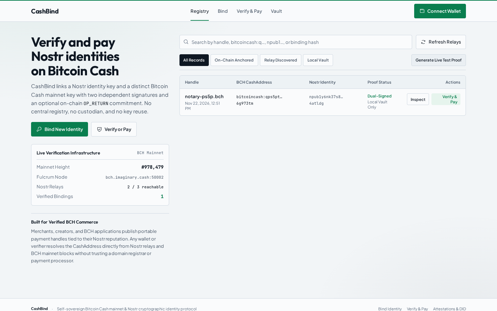
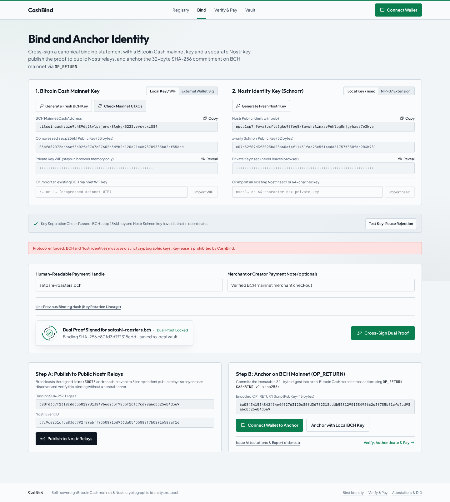
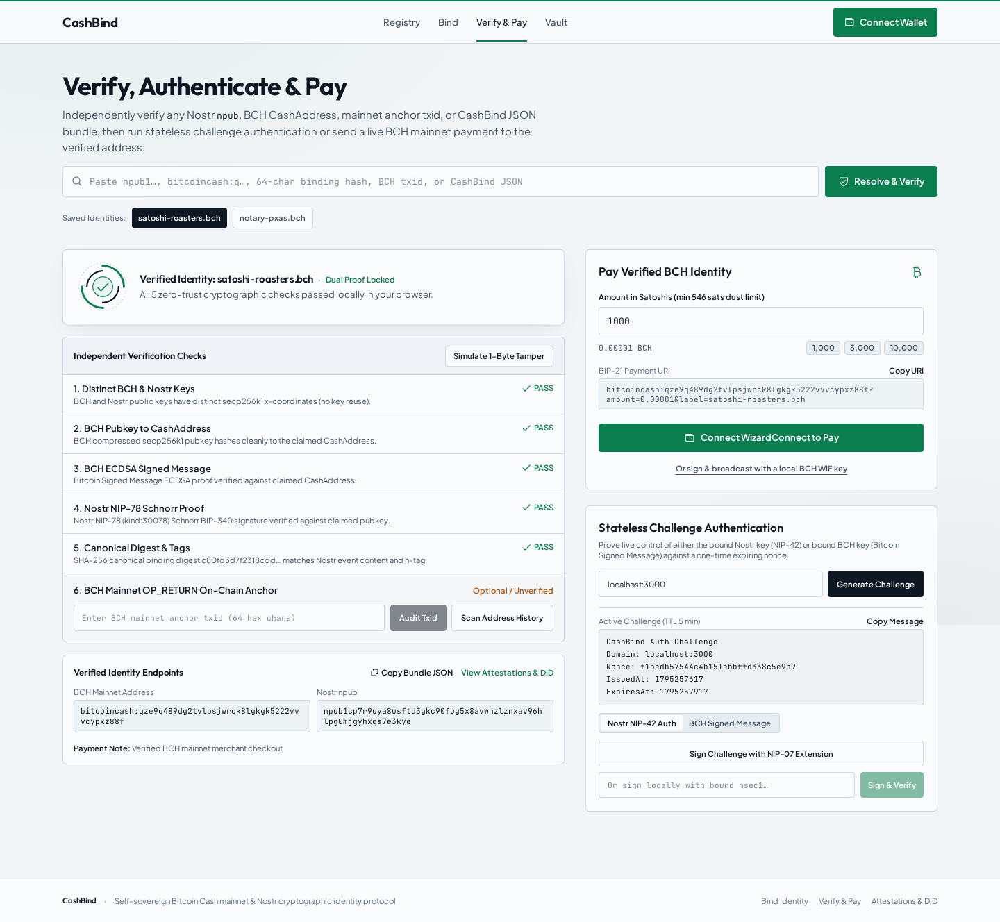
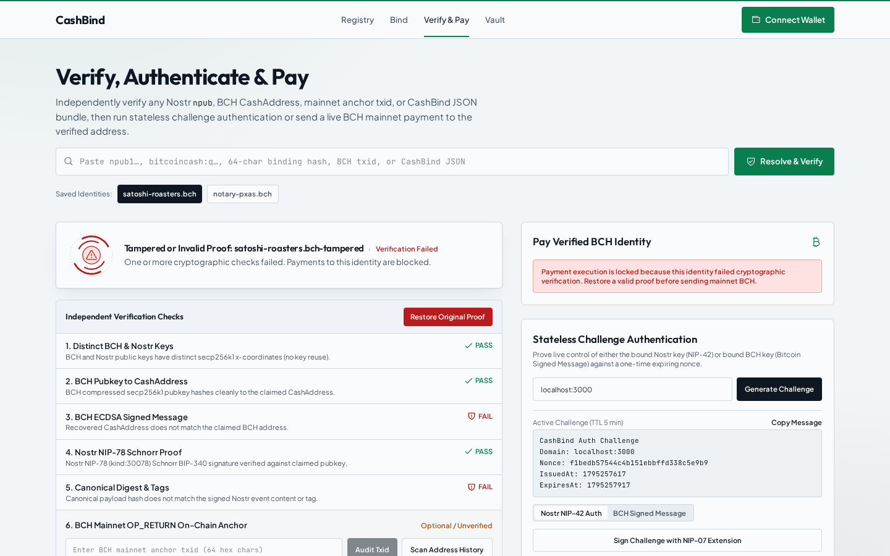
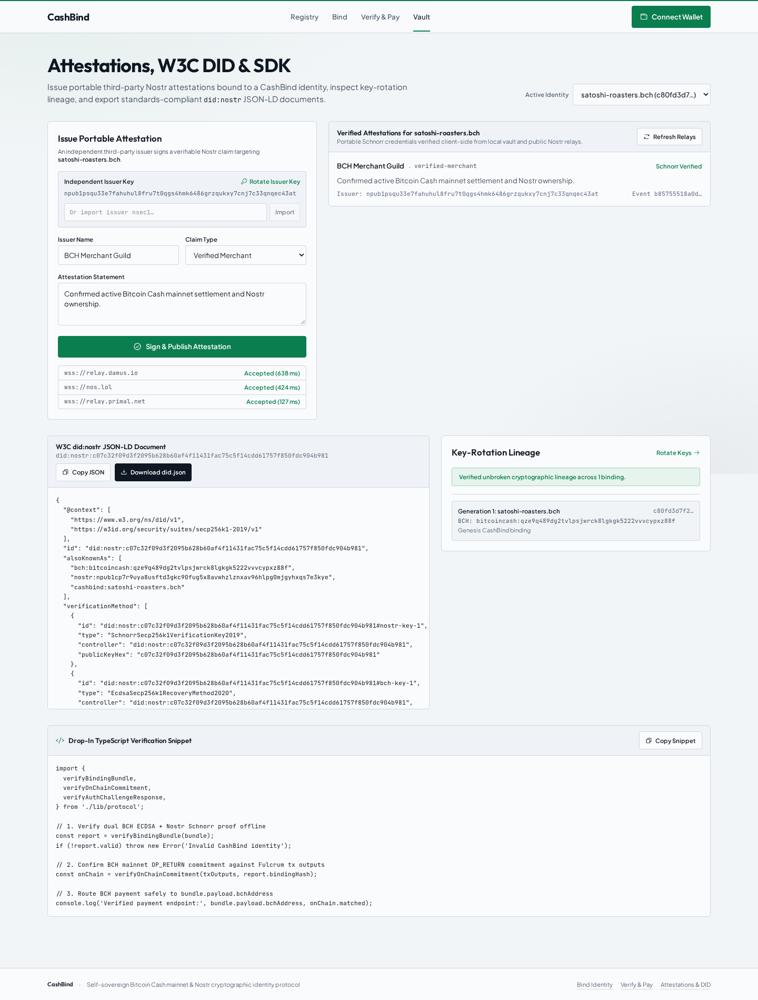

# CashBind

**Self-sovereign cryptographic identity bridge between Bitcoin Cash (BCH) mainnet and Nostr.**

- **Live App:** https://cashbind.vercel.app
- **Interactive Presentation Deck:** https://cashbind.vercel.app/deck.html
- **Google Slides / PowerPoint Deck (`.pptx`):** [`docs/CashBind-BLAZE-2026-Deck.pptx`](./docs/CashBind-BLAZE-2026-Deck.pptx)
- **Source Repository:** https://github.com/Pizzylee001/cashbind
- **License:** [MIT](./LICENSE)

---

## Overview

Merchants, creators, and developers on Nostr already own portable cryptographic identities (`npub`), yet accepting Bitcoin Cash still forces payers to trust bio screenshots, centralized handle directories, or domain registrars that can be silently hijacked.

CashBind replaces trust in intermediaries with a zero-trust cryptographic notary:

1. **Strict Key Separation (Zero Key Reuse):** A Bitcoin Cash `secp256k1` payment key and an independent Nostr BIP-340 Schnorr identity key cross-sign the exact same canonical JSON binding payload. Reusing the same keypair across BCH and Nostr is rejected at both creation and verification time.
2. **Bitcoin Cash Mainnet `OP_RETURN` Anchoring:** Commits a compact 46-byte digest (`OP_RETURN CASHBIND v1 <32-byte-sha256>`) to Bitcoin Cash mainnet using **WizardConnect** (`@wizardconnect/react` + `@wizardconnect/dapp`) or a local WIF key over live Fulcrum ElectrumX nodes.
3. **Zero Central Registry:** Bindings and third-party attestations publish directly from the browser to independent public Nostr relays (`wss://relay.damus.io`, `wss://nos.lol`, `wss://relay.primal.net`) and verify offline or against BCH mainnet blocks.
4. **Verify-Before-Pay Protection:** Before routing BCH to a Nostr identity, CashBind runs all 5 cryptographic checks locally. Mutating even a single byte fractures the Notary Seal and locks mainnet payment execution automatically.
5. **Stateless Challenge-Response Authentication:** Any application can authenticate a CashBind user with a one-time expiring nonce signed by either their bound Nostr key (NIP-42) or their bound BCH key (Bitcoin Signed Message).
6. **Portable Attestations, Key Rotation & W3C `did:nostr`:** Independent issuers sign verifiable Schnorr attestations targeting any binding hash, users rotate keys with unbroken cryptographic lineage (`prevBindingHash` / `prevTxid`), and any binding exports as a standards-compliant W3C `did:nostr` JSON-LD document.

---

## Application Screenshots

### 1. Live Mainnet Registry & Discovery (`/`)
Displays live Bitcoin Cash mainnet block height and Fulcrum node health, multi-relay Nostr `kind:30078` discovery, search and source filtering, instant local test-proof generation, and a slide-over cryptographic proof inspector.



### 2. Dual-Key Binding, Key-Reuse Rejection & Mainnet `OP_RETURN` Anchor (`/bind`)
Supports local keys, WIF/`nsec` import, NIP-07 browser extensions (Alby, nos2x), and External Wallet Signature mode (Paytaca, Electron Cash). Demonstrates protocol-level key-reuse rejection, publishes signed `kind:30078` events to public relays, and builds the exact 46-byte `CASHBIND|v1|<sha256>` `OP_RETURN` transaction for WizardConnect or local WIF broadcast.



### 3. Independent Verification, Stateless Auth & Direct BCH Payments (`/verify`)
Resolves any `npub1...`, `bitcoincash:q...`, binding digest, BCH mainnet txid, or raw CashBind JSON bundle. Runs 5 offline cryptographic checks plus live Fulcrum `OP_RETURN` auditing, stateless challenge authentication, BIP-21 payment URI generation, and live BCH mainnet payments with 546-satoshi dust-limit protection.



### 4. Live 1-Byte Tamper Detection & Automatic Payment Lock (`/verify`)
Mutating even a single character of a binding payload immediately fails ECDSA and canonical digest checks, breaks the Dual-Key Notary Seal, and disables mainnet payment execution.



### 5. Portable Third-Party Attestations, W3C `did:nostr` & Key-Rotation Vault (`/vault`)
Independent issuers sign and publish portable Schnorr attestations to public Nostr relays (`Accepted` across `relay.damus.io`, `nos.lol`, and `relay.primal.net`), while users inspect key-rotation lineage, export `.did.json` documents, and copy the drop-in TypeScript verification snippet.



---

## BCH BLAZE 2026 & Paytaca Bounty Alignment

| Requirement | Implementation in CashBind |
| :--- | :--- |
| **WizardConnect Integration** | Native `@wizardconnect/react` + `@wizardconnect/dapp` pairing with Paytaca, Selene, and Cashonize for non-custodial mainnet `OP_RETURN` anchoring and verified BCH payments. |
| **Real BCH Mainnet Utility** | Live Fulcrum proxy (`bch.imaginary.cash:50002`, `bch.loping.net:50002`, `wss://fulcrum.greyh.at:50004`) reads mainnet block height, UTXOs, `OP_RETURN` outputs, and broadcasts signed `SIGHASH_FORKID` transactions. |
| **Strict Distinct Keys** | Rejects any binding where BCH compressed pubkey and Nostr x-only pubkey share the same `secp256k1` x-coordinate (`areKeysDistinct`). |
| **Zero-Trust Verification & Auth** | Offline 5-check verifier (`verifyBindingBundle`), live on-chain `OP_RETURN` matcher (`verifyOnChainCommitment`), and expiring stateless challenge auth (`verifyAuthChallengeResponse`). |
| **Key Rotation & Portability** | Verifiable predecessor chain (`verifyRotationChain`), portable third-party Nostr attestations (`createSignedAttestation`), and W3C `did:nostr` JSON-LD export (`exportDidNostrDocument`). |
| **Commercial & Ecosystem Value** | Enables verifiable BCH merchant and creator payment handles plus paid third-party attestation directories settled directly on Bitcoin Cash mainnet. |

---

## System Architecture

```text
Browser Client (React 19 + TypeScript + Vite)
 ├── src/lib/protocol.ts        Isomorphic cryptography (@bitauth/libauth + nostr-tools)
 ├── src/lib/bchTx.ts           BCH mainnet P2PKH + OP_RETURN tx builder (SIGHASH_FORKID)
 ├── src/lib/wizardConnect.tsx  WizardConnect QR pairing & non-custodial tx signing
 ├── src/lib/nostrNetwork.ts    Direct parallel WebSockets to public Nostr relays
 └── src/lib/storage.ts         Local vault for public signed proofs (no private keys stored)
        │                                          │
        │ Direct WSS (kind:30078)                  │ HTTPS /api/bch/*
        ▼                                          ▼
Public Nostr Relays                        Fulcrum Mainnet Proxy (Express / Vercel Functions)
 ├── wss://relay.damus.io                   ├── GET  /api/bch/status
 ├── wss://nos.lol                          ├── GET  /api/bch/address/:address
 └── wss://relay.primal.net                 ├── GET  /api/bch/tx/:txid
                                            ├── GET  /api/bch/scan-commitments/:address
                                            └── POST /api/bch/broadcast
                                                   │
                                                   ▼
                                           BCH Mainnet Fulcrum Nodes
                                            ├── bch.imaginary.cash:50002 (TLS)
                                            ├── bch.loping.net:50002 (TLS)
                                            └── wss://fulcrum.greyh.at:50004 (WSS)
```

Private keys (`WIF` and `nsec`) remain strictly in browser memory and are never saved to `localStorage` or transmitted to any backend route.

---

## API Endpoints (`/api/bch/*`)

| Method & Path | Description |
| :--- | :--- |
| `GET /api/bch/status` | Queries live BCH mainnet block height and active Fulcrum node health. |
| `GET /api/bch/address/:address` | Fetches confirmed/unconfirmed balance and spendable UTXOs for any valid CashAddress. |
| `GET /api/bch/tx/:txid` | Fetches decoded mainnet transaction details, confirmations, and parsed `CASHBIND` `OP_RETURN` commitments. |
| `GET /api/bch/scan-commitments/:address` | Scans mainnet transaction history for an address to auto-discover CashBind `OP_RETURN` anchor txids. |
| `POST /api/bch/broadcast` | Broadcasts a signed raw Bitcoin Cash mainnet transaction hex (`{ rawTxHex }`) over Fulcrum failover. |

---

## 2-Minute Walkthrough

1. **Inspect Live Infrastructure (`/`):** Open https://cashbind.vercel.app to view live BCH mainnet block height from Fulcrum and public Nostr relay reachability. Click **Generate Live Test Proof** to inspect a genuine dual-signed identity immediately.
2. **Test Distinct Keys & Cross-Sign (`/bind`):** Click **Test Key-Reuse Rejection** to verify key separation, enter a handle, click **Cross-Sign Dual Proof**, and publish to public Nostr relays.
3. **Anchor on BCH Mainnet (`/bind`):** Click **Connect Wallet** in the top bar to pair Paytaca, Selene, or Cashonize via WizardConnect (or fund a local BCH address with ~1,000 sats), then broadcast the 46-byte `OP_RETURN` anchor transaction and verify the txid on Blockchair.
4. **Audit, Tamper-Test, Authenticate & Pay (`/verify`):** Toggle **Simulate 1-Byte Tamper** to observe cryptographic failure and automatic payment lock, restore the proof, audit the mainnet txid, run **Stateless Challenge Authentication**, and send a live BCH mainnet payment to the verified CashAddress.
5. **Attestations & W3C DID (`/vault`):** Sign and publish a third-party Schnorr attestation, inspect key-rotation lineage, and download the `did:nostr` JSON-LD document.

---

## Drop-In TypeScript Verification Usage

External Bitcoin Cash wallets and Nostr applications can verify a CashBind identity offline with zero server dependencies:

```ts
import {
  verifyBindingBundle,
  verifyOnChainCommitment,
  verifyAuthChallengeResponse,
} from './src/lib/protocol';

// 1. Verify dual BCH ECDSA + Nostr Schnorr proof offline
const report = verifyBindingBundle(bundle);
if (!report.valid) {
  throw new Error('CashBind cryptographic verification failed');
}

// 2. Confirm BCH mainnet OP_RETURN commitment against Fulcrum tx outputs
const onChain = verifyOnChainCommitment(txOutputs, report.bindingHash);

// 3. Route BCH payment safely to the verified CashAddress
console.log('Verified payment address:', bundle.payload.bchAddress, onChain.matched);
```

---

## Local Development & Deployment

### Requirements

- Node.js `>= 20` (tested on Node `22.x`)
- npm

### Run Locally

```bash
git clone https://github.com/Pizzylee001/cashbind.git
cd cashbind
npm install
npm run dev
```

Open `http://localhost:3000`.

### Deploy to Vercel

CashBind is pre-configured for zero-environment-variable deployment on **Vercel**:

- `vercel.json` builds the Vite SPA into `dist/`, preserves static `/deck.html` and `/deck-assets/*`, rewrites SPA routes (`/bind`, `/verify`, `/vault`) cleanly to `index.html`, and configures a 25-second timeout for Fulcrum failover queries.
- Serverless API routes under `api/bch/` (`status.ts`, `address/[address].ts`, `tx/[txid].ts`, `scan-commitments/[address].ts`, `broadcast.ts`) share the exact same Fulcrum mainnet failover module (`src/server/fulcrum.ts`) used in local development.
- Zero API keys or secrets are required in Vercel environment variables.

### Scripts

| Command | Description |
| :--- | :--- |
| `npm run dev` | Starts `server.ts` on port `3000` with Vite dev middleware and live `/api/bch/*` Fulcrum proxy routes. |
| `npm test` | Runs the 10-test cryptographic and BCH transaction suite (`tsx --test src/lib/protocol.test.ts`). |
| `npm run lint` | Runs strict TypeScript typechecking (`tsc --noEmit`). |
| `npm run build` | Compiles the production React SPA bundle into `dist/`. |
| `npm start` | Runs the production Express server (`server.ts`) serving `dist/` and `/api/bch/*`. |

### Unit Test Coverage (`npm test`)

1. Distinct BCH and Nostr keypair generation and WIF/`nsec` round-trip import.
2. Bitcoin Signed Message ECDSA signing, verification, and tamper rejection.
3. Bidirectional cross-signed `CashBindBundle` creation and 5-check verification.
4. Protocol rejection when BCH and Nostr reuse the exact same private key.
5. 46-byte `OP_RETURN CASHBIND v1 <sha256>` encoding, decoding, and output matching.
6. Real BCH mainnet P2PKH + `OP_RETURN` transaction construction, `SIGHASH_ALL | SIGHASH_FORKID` signing, and 546-satoshi dust enforcement.
7. Key-rotation lineage verification across chained bindings.
8. Stateless challenge-response authentication (Nostr NIP-42 + BCH ECDSA) and expiry rejection.
9. Third-party Schnorr attestation signing/verification and W3C `did:nostr` JSON-LD export.
10. Reversed SHA-256 ElectrumX scripthash derivation for Fulcrum queries.

---

## Documentation Index

- [`PROTOCOL.md`](./PROTOCOL.md): Canonical JSON schema, signature rules, NIP-78 tag layout, and 46-byte `OP_RETURN` byte specification.
- [`ARCHITECTURE.md`](./ARCHITECTURE.md): Full system diagram, Fulcrum failover strategy, wallet signing modes, and threat model.
- [`DESIGN.md`](./DESIGN.md): Visual design system tokens, typography, and component architecture.
- [`docs/CashBind-BLAZE-2026-Deck.pptx`](./docs/CashBind-BLAZE-2026-Deck.pptx): Ready-to-import 6-slide widescreen PowerPoint / Google Slides presentation deck with live screenshots.
- [`public/deck.html`](./public/deck.html): Interactive 16:9 web presentation deck served at https://cashbind.vercel.app/deck.html with keyboard navigation and PDF export.
- [`WIDGET_FACTORY_PITCH.md`](./WIDGET_FACTORY_PITCH.md): Slide-by-slide presentation deck copy.

---

## License

This project is licensed under the [MIT License](./LICENSE).

---

Built for **BCH BLAZE 2026** (Mainnet Track and the Paytaca Decentralized Identity Bounty).
